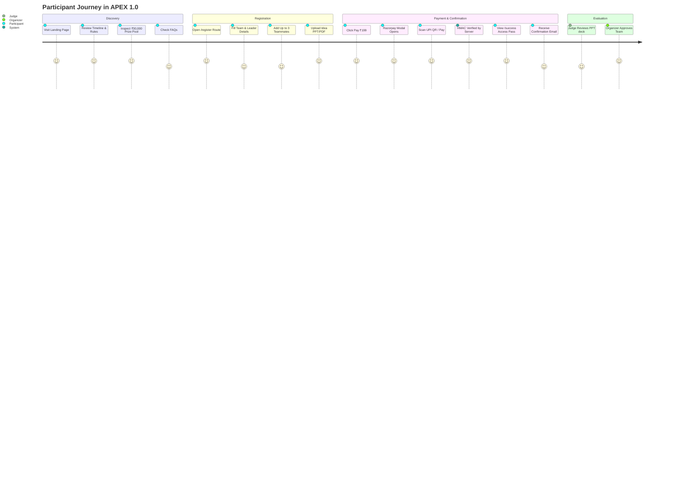

# APEX 1.0 — Complete Project Overview

## 1. Executive Summary
**APEX 1.0** is a full-stack, cyberpunk-themed hackathon management platform and registration portal designed for a national-level student open-innovation hackathon hosted at the **Tech Convention Centre in Bhopal, Madhya Pradesh**. 

The application streamlines the entire pre-event lifecycle:
- Public-facing marketing, event roadmaps, rules, judging rubrics, prize structures, and FAQs.
- Multi-member team registration (1 to 4 participants).
- Online presentation/pitch deck upload (PDF, PPT, PPTX) up to 20MB directly into cloud object storage.
- Integrated fee collection (₹199 per team for Round 1 screening) via **Razorpay Standard Checkout** with UPI, QR, Card, and NetBanking support.
- Cryptographic payment verification (HMAC-SHA256) and automated digital team pass generation (`APEX-XXXX`).
- Automated confirmation email dispatch.
- Organizer admin dashboard for reviewing submissions, inspecting presentations via signed URLs, updating team qualification statuses, and tracking registration metrics.

---

## 2. Problem Statement & Solution

### The Problem
Traditional student hackathons struggle with fragmented workflows:
1. **Disjointed Registration & File Collection:** Organizers use Google Forms or Typeform, leading to messy Google Drive link permissions, expired links, and oversized uploads.
2. **Manual Payment Verification:** Payment screenshots sent over WhatsApp or Google Form uploads require hours of manual reconciliation against bank statements, resulting in payment fraud, duplicate entries, and delayed confirmation.
3. **Poor Participant Experience:** Participants receive no instant confirmation pass, team ID, or transparent evaluation roadmap.
4. **Disorganized Review Process:** Judges must navigate shared spreadsheets and unsecured folders to review pitch presentations.

### The APEX Solution
APEX 1.0 provides a single, unified, automated system:
- **Zero-Friction Team Onboarding:** Dynamic team form adjusting dynamically from 1 to 4 members.
- **Secure Direct Storage:** Presentations are streamed directly into private/protected Supabase Storage (`apex-presentations`) with time-limited signed download URLs.
- **Automated Payment Settlement:** Real-time Razorpay order creation, client-side checkout, server-side cryptographic signature validation, and instant database settlement.
- **Immediate Participant Access Pass:** Unique `APEX-XXXX` player identifier generated sequentially from a PostgreSQL sequence, complete with copy-to-clipboard badges and calendar integration.
- **Centralized Organizer Operations:** Dedicated administrative console with real-time analytics, status management (Pending, Approved, Rejected), and one-click PPT downloads.

---

## 3. Target Audience & Stakeholders

| Stakeholder | Role in APEX 1.0 | Platform Interactions |
|---|---|---|
| **Student Participants** | Engineering and design college students forming teams of 1–4. | Browse event rules, timeline, prizes; submit project pitch; pay registration fee; receive team access pass and confirmation email. |
| **Hackathon Organizers** | Core student/faculty organizing committee in Bhopal. | Monitor total registrations, revenue, payment status; review idea decks; update team qualification statuses; send official announcements. |
| **Judges & Evaluators** | Industry experts and senior engineers. | Access submitted pitch decks via temporary signed URLs; evaluate entries against the 4 core criteria (Innovation, Execution, Impact, Presentation). |
| **Sponsors & Partners** | Tech companies, community partners, and local organizations. | Brand visibility across landing page sponsor tiers (Title, Gold, Tech, Community). |

---

## 4. Brand Identity & Design System
APEX 1.0 features a distinct **cyberpunk/noir terminal visual aesthetic**:
- **Palette:** Jet black background (`#07070a`), deep crimson accents (`#e11d48` / `#dc2626`), muted monospace borders, and cyan/purple subtle neon glows.
- **Typography:** Display fonts paired with monospace accents (`font-mono`) simulating tactical operations terminals.
- **Metaphors:** Military and tactical system labels (`SYSTEM_12 / ENTRY`, `PROTOCOL / SCORING`, `SIGNAL LOST`), poker suit identifiers (`spades`, `diamonds`, `clubs`, `hearts`), and sequential player IDs (`APEX-1001`).

---

## 5. End-to-End Participant Journey

---

## 6. Business & Monetization Model
1. **Entry Fee (Round 1 Online Screening):** ₹199 per team.
   - Purpose: Filters serious participants, covers payment gateway charges, infrastructure costs, and contributes to the prize pool.
2. **Prize Pool Distribution (₹30,000 Total):**
   - 1st Place (Champion): ₹18,000
   - 2nd Place (Runner Up): ₹8,000
   - 3rd Place (2nd Runner Up): ₹4,000
   - 6 Special Track Awards: Best AI Solution, Best UI/UX, Best Social Impact, Best Beginner Team, Most Creative Idea, People's Choice.
3. **Sponsorship Tiers:**
   - Title Sponsor (1 slot)
   - Gold Partner (3 slots)
   - Tech Partner (4 slots)
   - Community Partner (5 slots)
