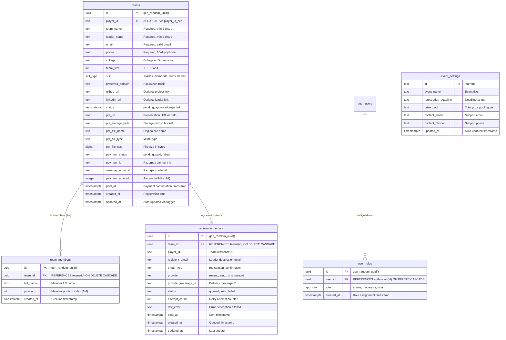

# APEX 1.0 — Database Architecture & Schema Documentation

This document provides a complete technical audit of the PostgreSQL database hosted on **Supabase** (`https://uzhovtxpuqyrtnfzoyuz.supabase.co`).

---

## 1. Entity-Relationship Diagram (ERD)

---

## 2. Table Specifications

### 2.1 Table: `public.teams`
The central registry for all hackathon teams.
- **Primary Key:** `id` (UUID).
- **Unique Constraints:**
  - `player_id` (Unique sequential identifier e.g. `APEX-1001`).
  - Partial Unique Index: `teams_email_paid_unique_idx` on `(email) WHERE payment_status = 'paid'` (prevents the same email from paying twice).
- **Triggers:** `teams_updated_at` before update executes `public.update_updated_at_column()`.
- **Indexes:**
  - `teams_email_idx` on `email`
  - `teams_player_id_idx` on `player_id`
  - `teams_razorpay_ord_idx` on `razorpay_order_id`
  - `teams_payment_ord_idx` on `payment_order_id`
  - `teams_payment_status_idx` on `payment_status`
  - `teams_created_at_idx` on `created_at DESC`

### 2.2 Table: `public.team_members`
Stores teammates 2, 3, and 4 associated with a team registration.
- **Primary Key:** `id` (UUID).
- **Foreign Key:** `team_id` references `public.teams(id)` with `ON DELETE CASCADE`.
- **Fields:** `full_name` (Text), `position` (Integer: 1 to 4).

### 2.3 Table: `public.event_settings`
Singleton table holding dynamic event dates, contact info, and prize metadata.
- **Primary Key:** `id` (Text, default `'current'`).
- **Fields:** `event_name`, `registration_deadline`, `prize_pool`, `contact_email`, `contact_phone`, `updated_at`.

### 2.4 Table: `public.registration_emails`
Audit log and delivery tracker for automated emails.
- **Primary Key:** `id` (UUID).
- **Foreign Key:** `team_id` references `public.teams(id)` with `ON DELETE CASCADE`.
- **Unique Constraint:** `registration_emails_team_type_unique` on `(team_id, email_type)` guarantees idempotency and eliminates duplicate sends.
- **Indexes:**
  - `registration_emails_team_id_idx`
  - `registration_emails_player_id_idx`
  - `registration_emails_status_idx`

### 2.5 Table: `public.user_roles`
RBAC storage for assigning administrative and moderator roles to Supabase Auth users.
- **Primary Key:** `id` (UUID).
- **Foreign Key:** `user_id` references `auth.users(id)` with `ON DELETE CASCADE`.
- **Unique Constraint:** `(user_id, role)`.

---

## 3. Storage Bucket: `apex-presentations`
- **Bucket ID:** `apex-presentations`
- **Visibility:** `public = true`
- **File Size Limit:** 20,971,520 bytes (20 MB).
- **Allowed MIME Types:**
  - `application/pdf` (.pdf)
  - `application/vnd.ms-powerpoint` (.ppt)
  - `application/vnd.openxmlformats-officedocument.presentationml.presentation` (.pptx)
- **Policies on `storage.objects`:**
  - `Allow public uploads to apex-presentations`: `INSERT TO anon, authenticated WITH CHECK (bucket_id = 'apex-presentations')`.
  - `Allow public select from apex-presentations`: `SELECT TO anon, authenticated USING (bucket_id = 'apex-presentations')`.

---

## 4. Row-Level Security (RLS) & Permissions Audit

| Table | Policy Name | Command | Role | Expression | Risk Rating |
|---|---|---|---|---|---|
| `public.teams` | `Service role full access on teams` | ALL | `service_role` | `true` | Low (Normal) |
| `public.teams` | `Allow anon insert to teams` | INSERT | `anon, authenticated` | `true` | Low (Required for public registration) |
| `public.teams` | `Allow anon select from teams` | SELECT | `anon, authenticated` | `true` | **HIGH** (Anyone can read all participant rows via anon key) |
| `public.teams` | `Allow anon update teams` | UPDATE | `anon, authenticated` | `true` | **CRITICAL** (Anyone can alter team status or details via anon key) |
| `public.team_members`| `Allow anon insert to team_members` | INSERT | `anon, authenticated` | `true` | Low |
| `public.team_members`| `Allow anon select from team_members` | SELECT | `anon, authenticated` | `true` | Medium |
| `public.event_settings`| `event settings are readable` | SELECT | `anon, authenticated` | `true` | Low |
| `public.registration_emails` | `Allow public select on registration_emails` | SELECT | `anon, authenticated` | `true` | Medium |

### Recommendations for RLS Hardening:
1. **Drop `Allow anon update teams`:** Updates to `teams` (e.g. changing `payment_status` to `'paid'` or `status` to `'approved'`) must ONLY be allowed by the `service_role` through authenticated backend API endpoints.
2. **Restrict `Allow anon select from teams`:** Public clients should only be able to query their own team by `player_id` or `razorpay_order_id`, rather than listing all 100+ participants across colleges.
