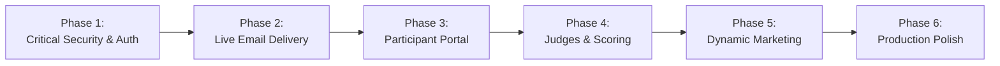

# APEX 1.0 — Practical Development Roadmap

This roadmap outlines the prioritized engineering tasks required to transition APEX 1.0 from its current pre-launch state into a hardened, production-grade hackathon management system.

---

## Roadmap Phases Overview

---

## Detailed Task Breakdown

### Phase 1: Critical Security & Access Control (Immediate Priority)
*Objective: Eliminate unauthorized access to participant personal data and administrative controls.*

| Task ID | Task Description | Priority | Files / Modules | Complexity | Dependencies |
|---|---|---|---|---|---|
| **P1-1** | **Build Admin Login Screen (`/admin/login`):** Create an authenticated login view with email & password or Magic Link via Supabase Auth. | **P0** | `frontend/src/routes/admin.login.tsx`, `frontend/src/components/admin/admin-shell.tsx` | Medium | Supabase Auth |
| **P1-2** | **Add Route Guard on Admin Routes:** Use TanStack Router `beforeLoad` to verify active session and check `user_roles.role === 'admin'`. | **P0** | `frontend/src/routes/admin.index.tsx`, `frontend/src/routes/admin.registrations.tsx` | Low | P1-1 |
| **P1-3** | **Enforce Backend Admin JWT Verification:** Update `authenticateAdmin` middleware to call `supabase.auth.getUser(token)` and verify user ID in `user_roles`. | **P0** | `backend/src/middleware/auth.middleware.ts` | Medium | Supabase SDK |
| **P1-4** | **Drop Permissive RLS Update Policy:** Remove `Allow anon update teams` from `public.teams` to prevent client-side tampering of registration status. | **P0** | `supabase/migrations/20261102_unified_setup.sql` | Low | None |
| **P1-5** | **Tighten Public Read Access on Teams:** Restrict `teams` read queries to match specific `player_id` or `razorpay_order_id` rather than allowing full table dumps. | **P1** | `supabase/migrations/20261102_unified_setup.sql` | Medium | P1-4 |

---

### Phase 2: Live Email & Notification Delivery (High Priority)
*Objective: Ensure every paying team receives an instant, deliverable email confirmation with their access pass.*

| Task ID | Task Description | Priority | Files / Modules | Complexity | Dependencies |
|---|---|---|---|---|---|
| **P2-1** | **Configure Production Email Credentials:** Add valid `RESEND_API_KEY` (or Gmail App Password in `SMTP_PASS`) to Render environment settings. | **P1** | Render Dashboard, `backend/.env` | Low | Resend / Gmail |
| **P2-2** | **Verify Live Inbox Delivery:** Execute end-to-end test verifying that confirmation emails render properly across Gmail, Outlook, and Apple Mail clients. | **P1** | `backend/src/services/email.service.ts` | Low | P2-1 |
| **P2-3** | **Automated Failed Delivery Alerts:** Log delivery failures to Discord / Slack webhook if email fails after maximum retry attempts. | **P2** | `backend/src/services/email.service.ts` | Medium | P2-1 |

---

### Phase 3: Participant Self-Service Portal (Medium Priority)
*Objective: Allow participants to retrieve their team pass or download receipt if they lose their confirmation URL.*

| Task ID | Task Description | Priority | Files / Modules | Complexity | Dependencies |
|---|---|---|---|---|---|
| **P3-1** | **Find My Pass Route (`/lookup`):** Create a search form where a participant enters their registered email or phone to receive their `APEX-XXXX` pass link. | **P2** | `frontend/src/routes/lookup.tsx`, `backend/src/controllers/registration.controller.ts` | Low | P1-5 |
| **P3-2** | **Update Pitch Deck Before Deadline:** Allow team leaders to re-upload an updated presentation deck before Round 1 deadline. | **P2** | `frontend/src/routes/register.tsx`, `backend/src/routes/upload.routes.ts` | Medium | P3-1 |

---

### Phase 4: Judges & Scoring Panel (Medium Priority)
*Objective: Facilitate online idea evaluation for Round 1 and live offline scoring for Round 2.*

| Task ID | Task Description | Priority | Files / Modules | Complexity | Dependencies |
|---|---|---|---|---|---|
| **P4-1** | **Judges Portal (`/judge`):** Protected route for judges to view assigned team pitch decks and input scores across the 4 criteria (Innovation, Execution, Impact, Presentation). | **P2** | `frontend/src/routes/judge.tsx`, `backend/src/controllers/admin.controller.ts` | High | P1-2 |
| **P4-2** | **Create Evaluation Schema:** New tables `public.evaluations` and `public.evaluation_scores` linked to `teams` and judge IDs. | **P2** | Supabase Migration | Medium | P4-1 |
| **P4-3** | **Round 1 Shortlisting Filter:** One-click batch approval of top-ranked teams with automated Round 2 invitation emails. | **P2** | `backend/src/controllers/admin.controller.ts` | Medium | P4-2 |

---

### Phase 5: Dynamic Marketing & Content Sync (Low Priority)
*Objective: Make marketing copy live and dynamic from the database rather than hardcoded in TypeScript files.*

| Task ID | Task Description | Priority | Files / Modules | Complexity | Dependencies |
|---|---|---|---|---|---|
| **P5-1** | **Dynamic Event Settings Hook:** Connect `useQuery(['event_settings'])` to `Hero` countdown, `RulesSection`, and `PrizesSection`. | **P3** | `frontend/src/hooks/use-event-settings.ts`, `frontend/src/components/sections/apex-sections.tsx` | Low | None |
| **P5-2** | **Live Sponsor Logos & Links:** Replace placeholder slots with actual logos and websites of confirmed hackathon partners. | **P3** | `frontend/src/components/sections/sponsors-section.tsx` | Low | None |
| **P5-3** | **Organizer Social Links:** Add LinkedIn / GitHub profile links for leadership committee members. | **P3** | `frontend/src/shared/data/apex.ts` | Low | None |

---

### Phase 6: Production Polish & Housekeeping (Low Priority)
*Objective: Clean up dead code, optimize bundle size, and automate CI/CD.*

| Task ID | Task Description | Priority | Files / Modules | Complexity | Dependencies |
|---|---|---|---|---|---|
| **P6-1** | **Remove Legacy Cashfree Service:** Safely delete `backend/src/services/cashfree.ts` and `frontend/src/cashfree.d.ts`. | **P3** | `backend/src/services/cashfree.ts` | Low | None |
| **P6-2** | **GitHub Actions CI/CD Pipeline:** Automate `npm run build` and lint checks on every pull request to `main`. | **P3** | `.github/workflows/ci.yml` | Low | None |
