# APEX 1.0 — Technical Architecture

This document details the software architecture, design patterns, technology stack, and runtime execution models powering the APEX 1.0 platform.

---

## 1. System Architecture Overview

```mermaid
flowchart TD
    subgraph Clients["Participant & Admin Clients"]
        BrowserMobile["Mobile Browser (Chrome/Safari)"]
        BrowserDesktop["Desktop Browser"]
    end

    subgraph CDN_Edge["Frontend Edge (Vercel)"]
        ViteSPA["React 19 SPA (Vite 8)"]
        Router["TanStack Router (File-based)"]
        QueryClient["TanStack Query Cache"]
    end

    subgraph Gateway["Payment Gateway"]
        RazorpayAPI["Razorpay Payment Gateway (Live Mode)"]
        UPI_Switch["NPCI / UPI Apps (GPay, PhonePe, Paytm)"]
    end

    subgraph Backend_Compute["Backend Compute (Render / Node.js)"]
        ExpressApp["Express.js 4.21 Server (ESM)"]
        Middleware["CORS / Error Handler / Multer"]
        Controllers["Payment / Registration / Admin / Upload / Email"]
        CryptoService["HMAC-SHA256 Signature Engine"]
        EmailService["Email Dispatcher (Resend / SMTP)"]
    end

    subgraph Data_Storage["Cloud Storage & Database (Supabase)"]
        PostgresDB[("PostgreSQL 15 (Supabase)")]
        RLS["Row-Level Security Policies"]
        StorageEngine["Supabase Storage: apex-presentations"]
        LocalDiskFallback["Local Disk Storage (uploads/submissions)"]
    end

    BrowserDesktop --> ViteSPA
    BrowserMobile --> ViteSPA
    ViteSPA --> Router
    Router --> QueryClient

    ViteSPA -- "1. /api/create-order" --> ExpressApp
    ExpressApp -- "2. Create Order (₹199)" --> RazorpayAPI
    RazorpayAPI -- "3. Return order_id" --> ExpressApp
    ExpressApp -- "4. Save pending team" --> PostgresDB
    ExpressApp -- "5. Return order credentials" --> ViteSPA

    ViteSPA -- "6. Open Razorpay Modal" --> RazorpayAPI
    RazorpayAPI <--> UPI_Switch

    ViteSPA -- "7. Submit Payment Signature" --> ExpressApp
    ExpressApp -- "8. Validate HMAC-SHA256" --> CryptoService
    CryptoService -- "Valid" --> ExpressApp
    ExpressApp -- "9. Update status: paid" --> PostgresDB
    ExpressApp -- "10. Trigger Async Email" --> EmailService

    ViteSPA -- "Upload PPT (<=20MB)" --> ExpressApp
    ExpressApp --> StorageEngine
    ExpressApp -. Fallback .-> LocalDiskFallback
```

---

## 2. Technology Stack & Versions

### Frontend Stack
- **Framework:** React 19 (`19.0.0`)
- **Build Tool:** Vite 8 (`8.1.5`)
- **Routing:** TanStack Router (`@tanstack/react-router` v1.114.1) with code splitting and route tree generation.
- **Server State Management:** TanStack Query (`@tanstack/react-query` v5.67.1).
- **Styling:** Tailwind CSS v4 (`@tailwindcss/vite` v4.0.0-beta.8) with modern CSS variables.
- **Component Primitives:** Radix UI (`@radix-ui/react-dialog`, `@radix-ui/react-select`, `@radix-ui/react-tabs`, etc.).
- **Animation & Motion:** Framer Motion (`framer-motion` v12.4.7) for reveals, badges, and progress transitions.
- **Forms & Validation:** React Hook Form (`react-hook-form` v7.54.2) + Zod (`zod` v3.24.2) with dynamic cross-field validation (`superRefine`).
- **Icons & Visuals:** Lucide React (`lucide-react` v0.475.0), Recharts (`recharts` v2.15.1), Canvas stars particle field.
- **Notifications:** Sonner toast manager (`sonner` v2.0.1).

### Backend Stack
- **Runtime:** Node.js (Target: Node 20+, tested on Node 26) with native ES Modules (`"type": "module"`).
- **Framework:** Express.js (`4.21.2`).
- **Language & Compiler:** TypeScript (`5.8.3`), `tsx` (`4.19.3`) for development watch mode.
- **File Upload Engine:** Multer (`2.4.0`) memory storage with MIME & extension whitelisting and 20MB limit.
- **Payment SDK:** Razorpay Official Node SDK (`razorpay` v2.9.8).
- **Email Delivery:** Resend SDK (`resend` v6.32.1) + Nodemailer (`nodemailer` v10.1.1).
- **Schema Validation:** Zod (`zod` v3.25.76).
- **Database Client:** `@supabase/supabase-js` (`v2.115.0`).

### Database & Storage Stack
- **Database:** Supabase managed PostgreSQL 15+.
- **Authentication:** Supabase Auth (configured for admin role mapping via `user_roles`).
- **Object Storage:** Supabase Storage (`storage.buckets` and `storage.objects`).
- **Procedural Logic:** PL/pgSQL triggers (`update_updated_at_column`), sequential generators (`player_id_seq`).

---

## 3. Core Software Design Patterns

### Pattern 1: Resilient Multi-Tier Storage (Cloud + Local Fallback)
The platform ensures that user idea presentations are never lost, even if Supabase is temporarily unreachable:
1. **Tier 1 (Cloud):** Multer streams file bytes in-memory and uploads to Supabase Storage bucket `apex-presentations`.
2. **Tier 2 (Local Disk):** If Supabase storage is offline or returns an error, the backend persists the file into `uploads/submissions/` on the server disk.
3. **Signed Access Resolver:** When an admin downloads a presentation, `getFileUrl` automatically checks whether the file lives on disk or in Supabase, generating a 1-hour signed URL or a secure streaming endpoint accordingly.

### Pattern 2: Server-Side Authoritative Pricing
To eliminate client-side price tampering:
- The registration fee (₹199 / 19900 paise) is strictly declared and enforced on the backend in [`registration.service.ts`](file:///Users/akashlodhi/Desktop/Hack_website/backend/src/services/registration.service.ts).
- Even if a malicious participant alters the frontend bundle to request ₹1, the backend ignores client amounts and creates the Razorpay order strictly for ₹199.

### Pattern 3: Dual-Mode Client Auto-Routing
[`frontend/src/lib/api.ts`](file:///Users/akashlodhi/Desktop/Hack_website/frontend/src/lib/api.ts) contains intelligent environment resolution:
- **Local Dev Mode:** When loaded on `localhost`, `127.0.0.1`, or `.local`, the frontend uses relative paths (`""`), letting Vite's proxy route requests seamlessly to `http://localhost:5002`.
- **Production Mode:** In deployed environments (Vercel), it resolves `VITE_API_URL` to route directly to the Render backend service or uses Vercel rewrites.

### Pattern 4: Cryptographic Payment Idempotency
- Payment signatures are verified using `crypto.timingSafeEqual` over `crypto.createHmac("sha256", KEY_SECRET)`.
- If a user clicks verify multiple times or Razorpay sends duplicate callbacks, the backend checks `if (team.payment_status === "paid")` and immediately returns the cached success response without duplicate processing or duplicate email dispatch.

### Pattern 5: Multi-Provider Email Fallback with In-Memory & DB Deduplication
The email service implements a 3-layer delivery strategy:
1. Try **Resend API** (if `RESEND_API_KEY` exists).
2. Fallback to **Gmail SMTP** (if `SMTP_PASS` exists).
3. Fallback to **Simulated Logger** (logs delivery in development without crashing).
4. All sent emails are deduplicated via an in-memory `Set` and checked against the `registration_emails` table before sending.
