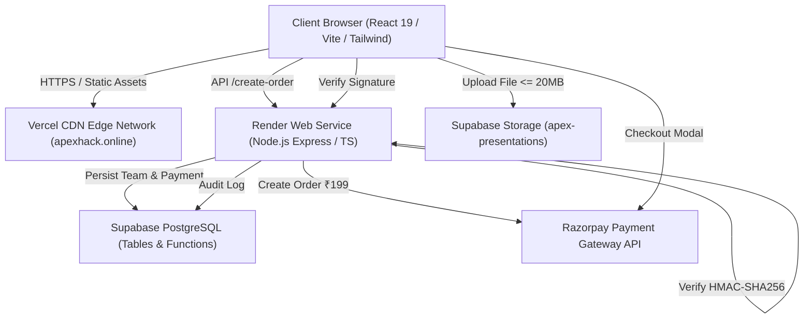

# APEX 1.0 — Technical Architecture & Systems Engineering

## 1. High-Level Architecture Diagram

---

## 2. Component Specifications

### Frontend Application
- **Runtime & Bundler:** Vite 8.x + React 19 + TypeScript.
- **Routing Engine:** TanStack Router (file-based routing with strict type safety).
- **Styling Architecture:** Tailwind CSS + Radix UI Primitives + Lucide Icons.
- **State & Form Management:** React Hook Form + Zod v3.
- **Security Posture:** Decoupled consent mechanisms, URL sanitization (rejection of `javascript:` and `data:` schemes), and strict token isolation in session storage.

### Backend Microservice
- **Runtime:** Node.js 20+ LTS with Express and TypeScript.
- **Deployment Platform:** Render Web Service (`https://apex-backend-rik9.onrender.com`).
- **Security Middleware:** CORS with origin validation, timing-safe authorization tokens, payload verification, and centralized error sanitization.
- **Payment Verification:** Server-side HMAC-SHA256 cryptographic verification using node's built-in `crypto.timingSafeEqual`.

### Data & Cloud Storage Tier
- **Database Engine:** Supabase Managed PostgreSQL.
- **Storage Subsystem:** S3-compatible Supabase Storage bucket `apex-presentations` with mime-type restrictions (`pdf`, `ppt`, `pptx`) and a strict 20MB file size ceiling.
